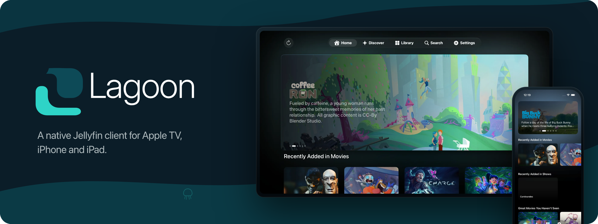
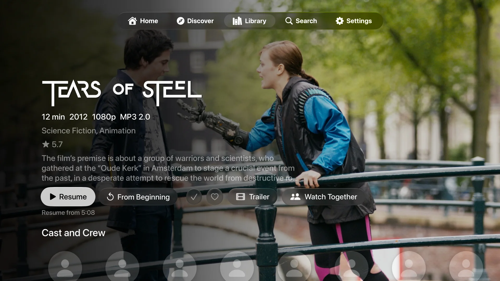
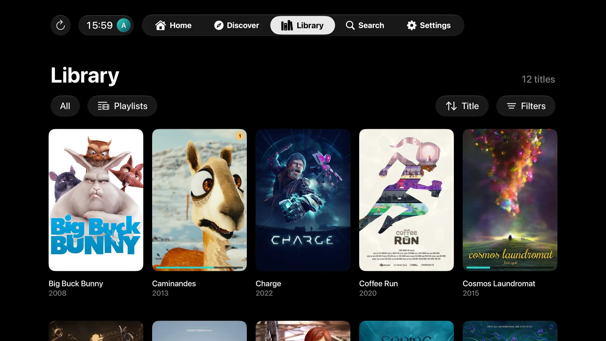
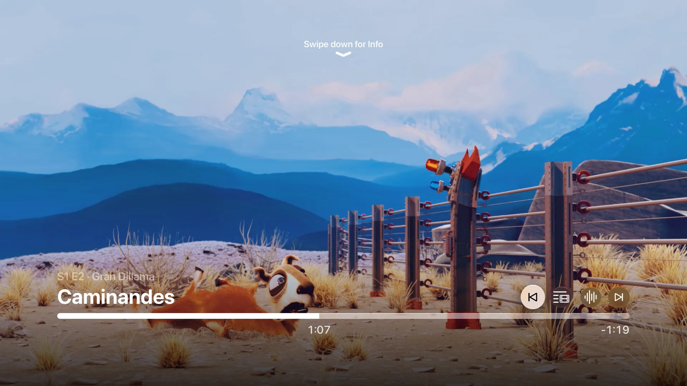
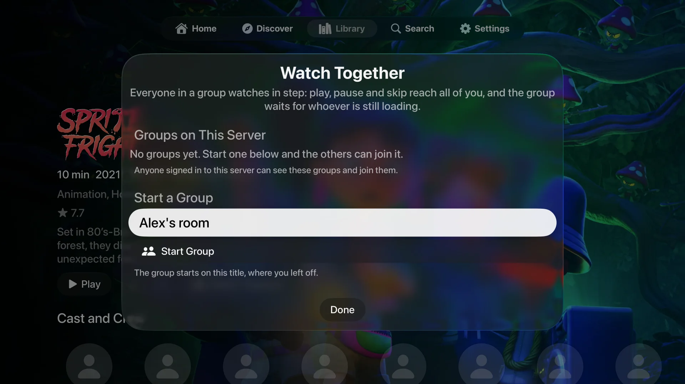

  

  
  
  
  
  
  

  
  
  

  
  
  
  

## Features

- **Sign in** by address, without a scheme or port, with a password or Quick Connect, or pick a server found on your network
- **Profiles** for every Jellyfin user on a shared device, on one server or several, with sessions kept in the keychain
- **Home and Discover** with featured banners and native rows you can reorder or hide, no Home Screen Sections plugin needed (although it is supported)
- **Library** of Movies and Shows with sorting and filters, remembered per account
- **Detail pages** with seasons, an episode rail, resume points, trailers and a page for everyone in the cast and crew
- **Collections and playlists** that play straight through, like episodes
- **Playback** that plays the file directly when it can and asks the server to transcode when it can't, with Dolby Vision, HDR10+ and Atmos ([codec support](docs/codec-support.md))
- **A player of its own** with Skip Intro, Skip Credits and Up Next, Night Mode and Dialogue Boost, playback speed and Picture in Picture
- **Subtitles** as text, styled ASS, images or closed captions, with a search that runs on your server
- **Search** across your library and Seerr
- **Seerr**, if you connect it, to browse and request what is not in your library yet
- **SyncPlay** to watch together with friends, family, enemies or loved ones
- **Downloads** for offline playback on iPhone and iPad
- **Themes**: Lagoon, Baby Pink, Spooky and Winter, with seasonal ones that arrive by themselves
- **iPhone Duo** layouts that keep clear of the fold
- **Top Shelf** with what you are watching, on the Apple TV Home Screen
- **Servers behind an access proxy**, such as Cloudflare Access, Authelia or Authentik
- **Liquid Glass** on tvOS 26, dark on both platforms

## More

- [FAQ](FAQ.md): why another client, AI use, formats, Jellyfin versions, telemetry
- [Contributing](CONTRIBUTING.md): building, tests and the public demo server
- [Documentation](docs/README.md): architecture, design, Jellyfin API, playback and release
- [Security](SECURITY.md) reports go privately by email, and taking part means keeping to the [Code of Conduct](CODE_OF_CONDUCT.md)

## Licence

Lagoon's code is [MPL-2.0](LICENSE). The name and brand artwork are not part
of that grant, see [TRADEMARKS.md](TRADEMARKS.md). The native libraries carry
their own licences, in [`Lagoon/Resources/Licenses`](Lagoon/Resources/Licenses)
and in the app under Settings → About → Acknowledgements.
